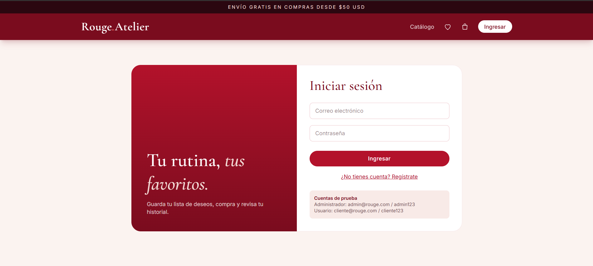
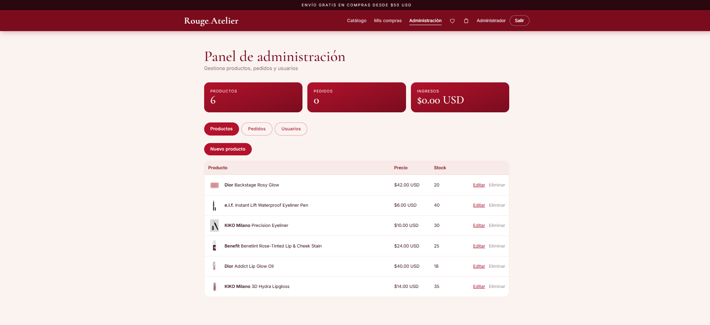
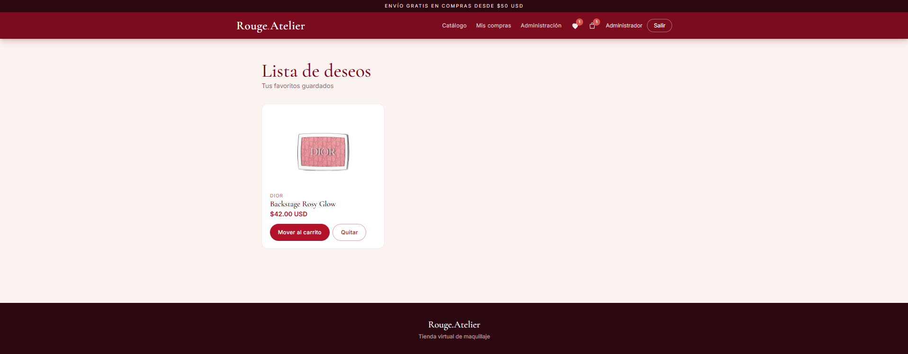
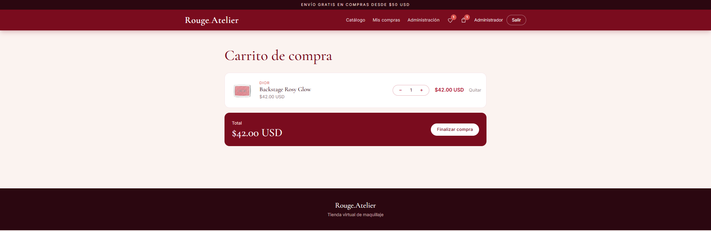
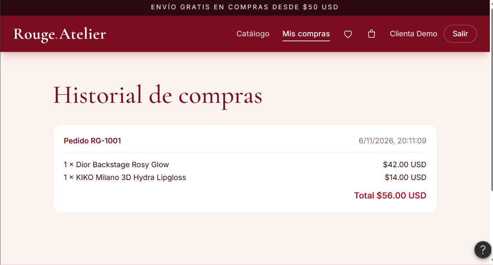
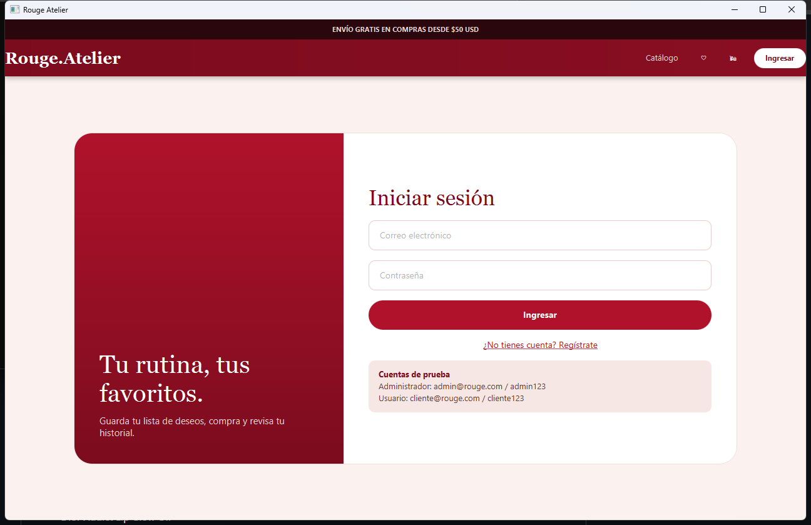
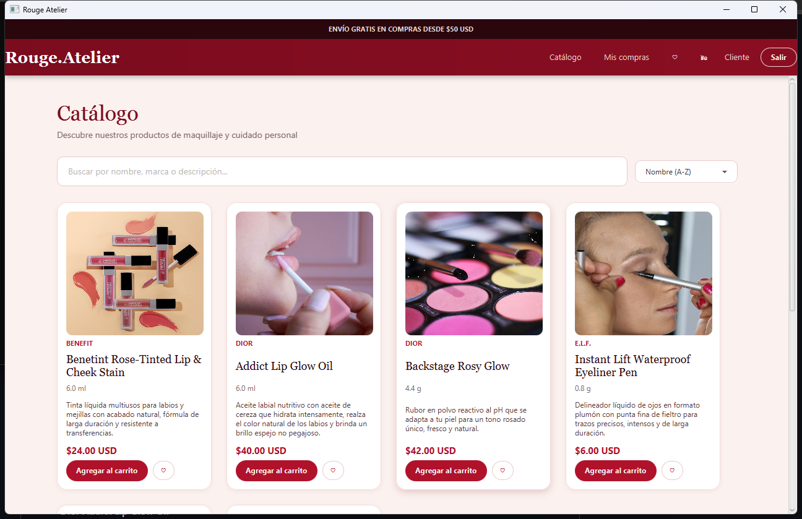
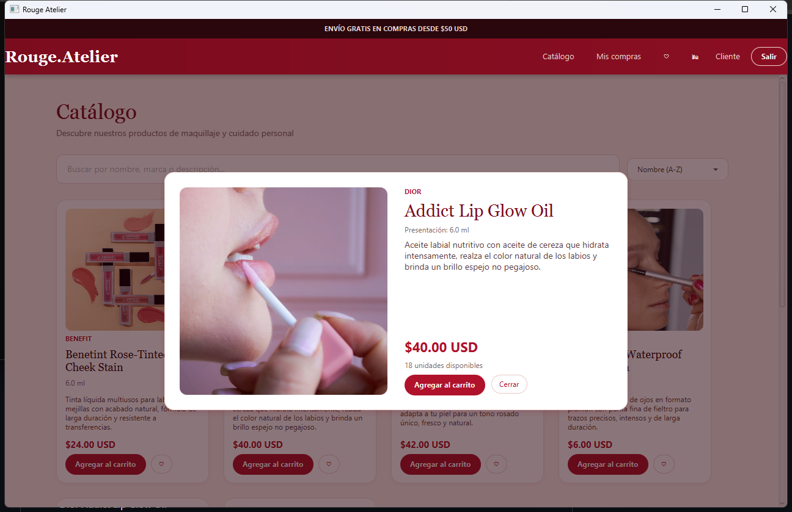

# Rouge Atelier — Tienda virtual de maquillaje

Plataforma de comercio electrónico de maquillaje y cuidado personal de marcas como **Dior**, **e.l.f.**, **KIKO Milano** y **Benefit**. El proyecto tiene dos partes: un **prototipo de alta fidelidad en Figma** y una **implementación en JavaFX** del login y del catálogo.

## Integrantes
- Juan Esteban Ballesteros
- Aylin Velásquez de la Ossa
- Omar Daniel Hernández

## Contenido
- [Prototipo en Figma](#prototipo-en-figma)
- [Implementación en JavaFX](#implementación-en-javafx)
- [Catálogo de productos](#catálogo-de-productos)
- [Cómo ejecutar](#cómo-ejecutar)
- [Estructura del proyecto](#estructura-del-proyecto)
- [Créditos](#créditos)

---

## Prototipo en Figma

Diseño completo y navegable: [Ver prototipo de Rouge Atelier en Figma](https://www.figma.com/make/cwLYH8ICQMCLCMa6wmzw83/Tienda-Virtual-de-Maquillaje?t=Z7uO1TreTkdOw1o7-1)

Funcionalidades diseñadas:
- **Login y registro** con cuentas de prueba para usuario y administrador.
- **Vistas por rol:** navegación de cliente o panel de administración.
- **Carrito de compra** para agregar productos y gestionar la compra.
- **Lista de deseos** con los productos favoritos.
- **Historial de compras** de cada usuario.

| Login | Panel de administración |
|:---:|:---:|
|  |  |

| Lista de deseos | Carrito de compra |
|:---:|:---:|
|  |  |

| Historial de compras |
|:---:|
|  |

---

## Implementación en JavaFX

Por ahora están implementados el **login** y el **catálogo**. El carrito, el panel de administración y el resto de pantallas quedan para una siguiente etapa.

**Qué hace hoy**
- **Login** con validación de credenciales y mensajes de error.
- **Catálogo** con los 6 productos del README.
- **Vista previa** del producto al hacer clic en su tarjeta (imagen, descripción, presentación, precio y stock).
- **Buscador en tiempo real** por nombre, marca o descripción (sin distinguir mayúsculas ni tildes).
- **Ordenamiento** por nombre (A-Z), precio de menor a mayor o de mayor a menor.
- Menú que cambia según el rol (el administrador ve la opción "Administración").

**Cuentas de prueba**

| Rol | Correo | Contraseña |
|---|---|---|
| Administrador | `admin@rouge.com` | `admin123` |
| Cliente | `cliente@rouge.com` | `cliente123` |

| Login | Catálogo |
|:---:|:---:|
|  |  |

| Vista previa del producto |
|:---:|
|  |

**Arquitectura:** patrón **Modelo – Vista – Controlador**. Cada vista es un archivo `.fxml` con su propio controlador, y los datos viven en listas simples en memoria (sin base de datos).

---

## Catálogo de productos

| Producto | Precio | Presentación | Stock | Descripción |
|---|---:|---|---:|---|
| **Dior** Backstage Rosy Glow | $42.00 USD | 4.4 g | 20 | Rubor en polvo reactivo al pH que se adapta a tu piel para un tono rosado único, fresco y natural. |
| **e.l.f.** Instant Lift Waterproof Eyeliner Pen | $6.00 USD | 0.8 g | 40 | Delineador líquido en formato plumón con punta fina de fieltro para trazos precisos, intensos y de larga duración. |
| **KIKO Milano** Precision Eyeliner | $10.00 USD | 2.5 ml | 30 | Delineador líquido fluido con aplicador de fieltro de alta precisión, pigmentación negra intensa y secado rápido. |
| **Benefit** Benetint Rose-Tinted Lip & Cheek Stain | $24.00 USD | 6.0 ml | 25 | Tinta líquida multiusos para labios y mejillas con acabado natural, larga duración y resistente a transferencias. |
| **Dior** Addict Lip Glow Oil | $40.00 USD | 6.0 ml | 18 | Aceite labial nutritivo con aceite de cereza que hidrata, realza el color natural y da un brillo espejo no pegajoso. |
| **KIKO Milano** 3D Hydra Lipgloss | $14.00 USD | 6.5 ml | 35 | Brillo de labios hidratante con efecto 3D y destellos, de textura suave, confortable y no pegajosa. |

---

## Cómo ejecutar

**Requisitos:** JDK 21 con JavaFX (por ejemplo, BellSoft Liberica *Full*) y Apache NetBeans.

1. Clona el repositorio:
   ```bash
   git clone https://github.com/danmiarbol34/Tienda-virtual.git
   ```
2. Abre la carpeta `miTiendaVirutual` como proyecto en NetBeans.
3. Verifica que la plataforma del proyecto sea **JDK 21 con JavaFX**.
4. Ejecuta la clase principal `controlador.Main` (Run Project).

## Estructura del proyecto

```
miTiendaVirutual/src
├── modelo/        Producto, Usuario y Tienda (datos en listas)
├── vista/         Archivos .fxml, estilos.css e imagenes/
└── controlador/   Main y un controlador por cada vista
docs/capturas/     Capturas del prototipo y de la aplicación
```

## Créditos

- Las fotografías de los productos son de [Pexels](https://www.pexels.com) y se usan como imágenes de referencia; no corresponden a los productos reales de las marcas.
- Las marcas mencionadas pertenecen a sus respectivos dueños; este es un proyecto académico sin fines comerciales.
